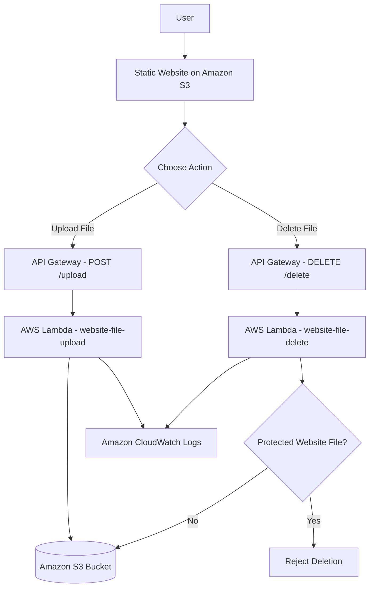

# Automated Static Website Hosting Using AWS SDK 5

## 1. Project Overview

This project demonstrates static website hosting on Amazon S3 and automated file management using Python Boto3, AWS Lambda, and Amazon API Gateway.

Users can access a website dashboard, upload files to Amazon S3, and request deletion of uploaded files through API endpoints. AWS CloudWatch is used to monitor Lambda execution logs.

## 2. Project Objectives

* Host a static website on Amazon S3.
* Automate website deployment using Python Boto3.
* Upload files through a web dashboard.
* Delete uploaded files through an API.
* Monitor serverless operations using CloudWatch.
* Apply IAM permissions and AWS security best practices.

## 3. AWS Services Used

| Service            | Purpose                                       |
| ------------------ | --------------------------------------------- |
| Amazon S3          | Hosts website files and stores uploaded files |
| AWS Lambda         | Processes file upload and deletion requests   |
| Amazon API Gateway | Provides HTTP API endpoints                   |
| AWS IAM            | Controls access to AWS resources              |
| Amazon CloudWatch  | Stores Lambda execution logs                  |
| Python Boto3       | Automates S3 file uploads                     |

## 4. Architecture and Workflow




## 5. Project Files

* `index.html` — Website dashboard and structure.
* `style.css` — Website styling.
* `script.js` — Upload and delete functionality.
* `upload_to_s3.py` — Uploads website assets using Boto3.
* `README.md` — Project documentation.

## 6. AWS Configuration

* **AWS Region:** `ap-south-1` (Asia Pacific — Mumbai)
* **S3 Bucket:** `aws-static-website-sdk-bhimashankar-2026`
* **Upload Lambda:** `website-file-upload`
* **Delete Lambda:** `website-file-delete`
* **API Gateway:** `website-file-upload-api`

### API Routes

* `POST /upload` — Uploads a file to S3.
* `DELETE /delete` — Requests deletion of a file from S3.

The API base URL is configured in `script.js`.

## 7. Setup and Deployment

### Prerequisites

* An AWS account.
* Python installed.
* AWS CLI installed and configured.
* Boto3 installed.
* An S3 bucket, Lambda functions, and API Gateway routes configured.

### Step 1: Install Boto3

```bash
python -m pip install boto3
```

### Step 2: Configure AWS CLI

```bash
aws configure
```

Use an authorized IAM identity. Never commit AWS access keys or secret keys to GitHub.

### Step 3: Upload Website Files

Open the terminal in the project folder and run:

```bash
python upload_to_s3.py
```

The script uploads the website assets to the configured S3 bucket.

### Step 4: Configure API Gateway

Configure the following routes:

* `POST /upload` → `website-file-upload`
* `DELETE /delete` → `website-file-delete`

Configure CORS for the intended website origin and deploy the API changes.

### Step 5: Test the Project

1. Open the website.
2. Upload a test file.
3. Verify the file in Amazon S3.
4. Check upload Lambda logs in CloudWatch.
5. Test deletion with a non-essential test file.
6. Verify the result in S3 and check the delete Lambda logs.

## 8. Security Best Practices

* Keep S3 Block Public Access enabled when using a private-bucket architecture.
* A public S3 website endpoint requires public access to website content. For a production website, consider CloudFront with Origin Access Control and a private S3 bucket.
* Protect upload and delete APIs with authentication and authorization before production use.
* Grant each Lambda function only the IAM permissions it needs.
* Validate uploaded file types and sizes.
* Protect essential website files from deletion.
* Never upload AWS credentials or sensitive files to GitHub.
* Review CloudWatch logs and AWS costs regularly.

**Security status:** These are recommended practices. Verify the actual bucket settings, API authorization, and IAM policies before claiming the deployment is secure.

## 9. Screenshots

Create a `screenshots` folder and add screenshots of:

1. Website dashboard.
2. Successful file upload.
3. S3 bucket objects.
4. API Gateway routes.
5. Lambda functions.
6. CloudWatch logs.
7. Successful file deletion.

Add screenshots to this README using Markdown, for example:

```markdown

```

## 10. Key Learnings

* Static website hosting with Amazon S3.
* AWS automation using Python Boto3.
* Serverless application development with Lambda.
* HTTP APIs using API Gateway.
* IAM permissions and access control.
* Monitoring with CloudWatch.

## 11. Future Improvements

* Add authentication for file management APIs.
* Add file listing and search.
* Validate file types and file sizes.
* Use CloudFront and HTTPS for website delivery.
* Improve monitoring and error handling.
## Project Screenshots

### 1. AWS Website Dashboard


### 2. Website Upload Interface


### 3. AWS Project Testing


## Author

AWS Cloud and DevOps Learning Project
